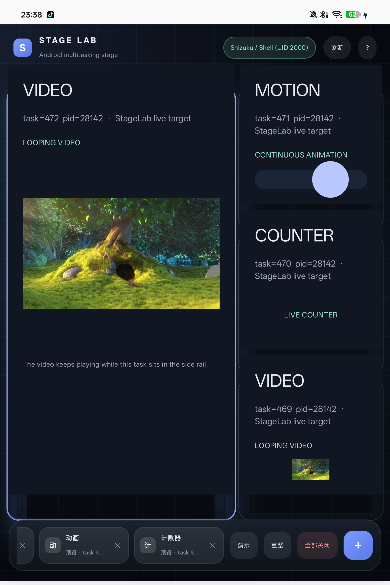
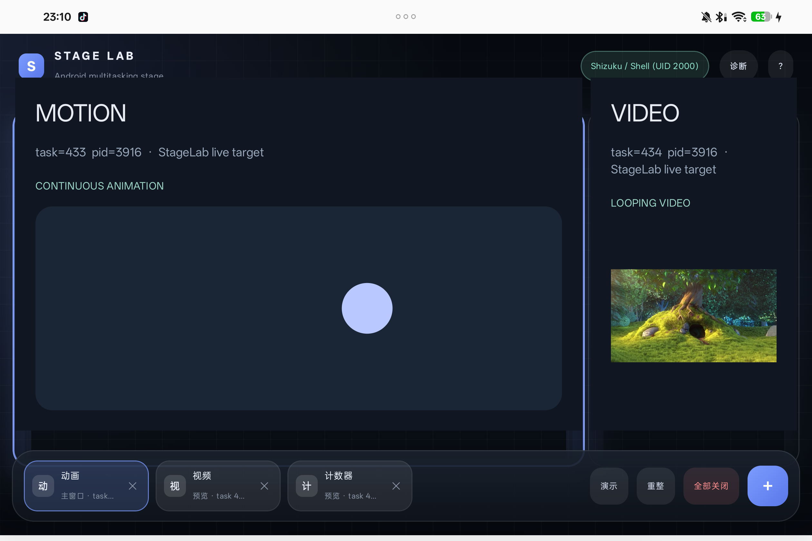

# StageLab — an iPad style Stage Manager for Android

StageLab turns an Android tablet into a real multi-window stage: several applications run as
genuine Android tasks at the same time, each window is a live system surface, and the dock can
move, resize, promote, park and close them.

It is **not** a launcher with screenshots. There is no MediaProjection, no WebView fake, no
periodic bitmap capture. Every window you see is the app's own `Surface` composited by
SurfaceFlinger, arranged by `WindowManager`.

Verified on **OPPO Pad mini (OPD2515)**, ColorOS 17.0.0.103, Android 17 / SDK 37, 1680×2520 @ 120 Hz.

| | |
|---|---|
|  |  |

## What works today

* **Three or more real tasks on screen at once** (FREEFORM windowing mode, system managed).
* **Live side previews** — the rail windows are the real tasks, continuously updating
  (measured: 19.9 %, 7.0 %, 1.9 % of pixels change per 1.5 s).
* **Focus switching without restarting** — tapping a preview promotes it to the main frame, the
  previous main window moves to the rail, and Android task ids are unchanged.
* **Move / resize / close / reopen / park** any staged window.
* **Portrait and landscape** layouts, recomputed on rotation.
* **IME works** inside a staged window (the keyboard belongs to the focused task, not to StageLab).
* **Self healing** — if the privileged service dies, the stage reconnects with backoff and restores
  the window set and geometry.
* **Persistence** — the window list survives process death; missing tasks are shown as
  “已关闭 · 点击恢复”.

## Permission tiers

StageLab always tries the lowest privilege that can do the job.

| Tier | Requirement | What it can do |
|---|---|---|
| Level 1 | nothing | launch apps, show the stage chrome, list installed apps. Cannot host or arrange other apps' tasks (platform restriction). |
| Level 2 | **Shizuku** (Shell UID 2000) | full stage: create FREEFORM tasks, resize/move/focus/close them, live previews, IME. |
| Level 3 | **KernelSU / root** | same engine running as UID 0. Requires KernelSU to allow `su` for StageLab; see the capability matrix. |

The privileged engine is identical for every tier — only the transport differs
(Shizuku UserService / KernelSU `app_process` service / ADB loopback service).

## Quick start

```powershell
# build
./gradlew :app:assembleRelease

# install (ColorOS asks you to confirm the side-loaded APK once)
adb install -r app/build/outputs/apk/release/app-release.apk

# start Shizuku once per boot (root or the official adb starter)
adb shell /data/app/*/moe.shizuku.privileged.api*/lib/arm64/libshizuku.so

# run the acceptance scenario on the device
./scripts/device-smoke-test.ps1
```

Then open StageLab → “连接 Shizuku” → allow → press **＋** and pick apps, or press **演示** to open
the counter / motion / video test windows.

## How it works (short version)

1. The app asks the privileged service to start an app with
   `ActivityOptions#setLaunchBounds` + `setLaunchWindowingMode(FREEFORM)`.
2. The service (Shell UID) calls `IActivityTaskManager.startActivityAsUser`, then keeps the task
   list fresh through `getTasks`.
3. Geometry is applied with `IActivityTaskManager.resizeTask`; focus with `setFocusedTask`;
   closing with `removeTask`.
4. The stage UI is a full-screen, non-focusable window *behind* the tasks. It draws the desk,
   focus halos, top bar and dock; the task windows are composited above it by the system.
5. When the user taps a rail window, WindowManager focuses it. StageLab notices the focus change
   and swaps the rail and main rectangles — the task itself never restarts.

Details, including the AOSP references and the hidden API surface, are in
[docs/ARCHITECTURE.md](docs/ARCHITECTURE.md). Measured results are in
[docs/TEST_REPORT.md](docs/TEST_REPORT.md), and the per-tier truth table is in
[docs/CAPABILITY_MATRIX.md](docs/CAPABILITY_MATRIX.md).

## Known limitations (measured, not guessed)

* Freeform tasks have a system minimum size (~220 dp on this build). The rail is sized above it;
  extra windows are **parked behind the main window** instead of being squeezed out of the screen.
* Rotating to landscape leaves room for one preview, so the second preview is parked.
* Third-party apps may be recreated by Android when their window is resized. StageLab keeps the
  task and process, and the demo targets declare `configChanges` so their counters keep running.
* Launching a non-exported activity needs `START_ANY_ACTIVITY`, which Shell does not hold; the
  app picker therefore lists exported launcher activities only.
* KernelSU blocks `su` exec for `untrusted_app` until the user grants root to StageLab. The root
  engine itself is verified (see the test report).

## Repository layout

```
app/src/main/java/dev/stagelab/android/
  core/privileged/   engine that runs as Shell/Root: TaskMutations, StageEngine, organizers
  core/ipc/          transports (Shizuku UserService, KernelSU root, ADB loopback)
  core/stage/        layout engine + StageRuntime (state, polling, geometry sync)
  ui/                Compose stage, app picker, diagnostics
  demo/              live counter / motion / video test targets
scripts/             hidden API stubs, device smoke test, ADB service launcher
docs/                architecture, test report, capability matrix, device notes
```
