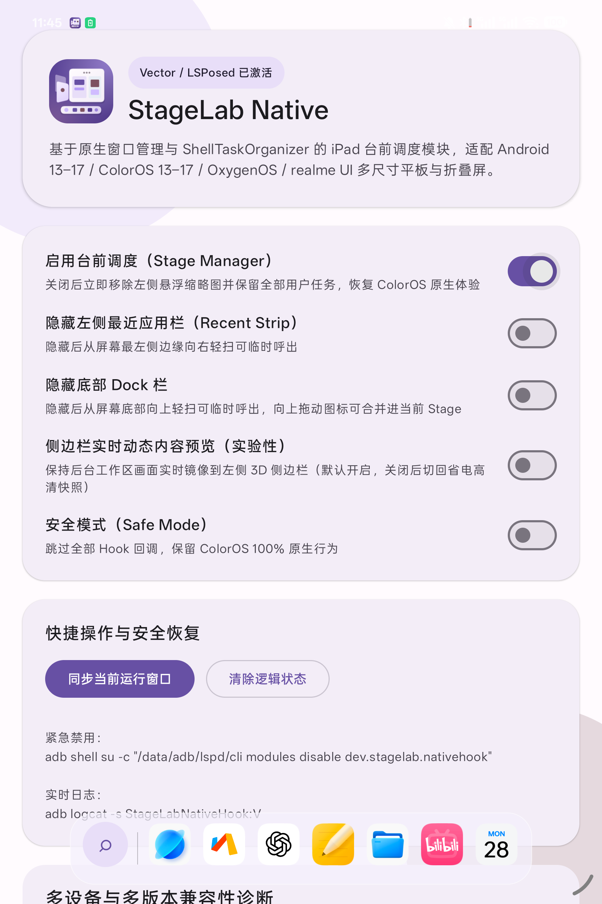
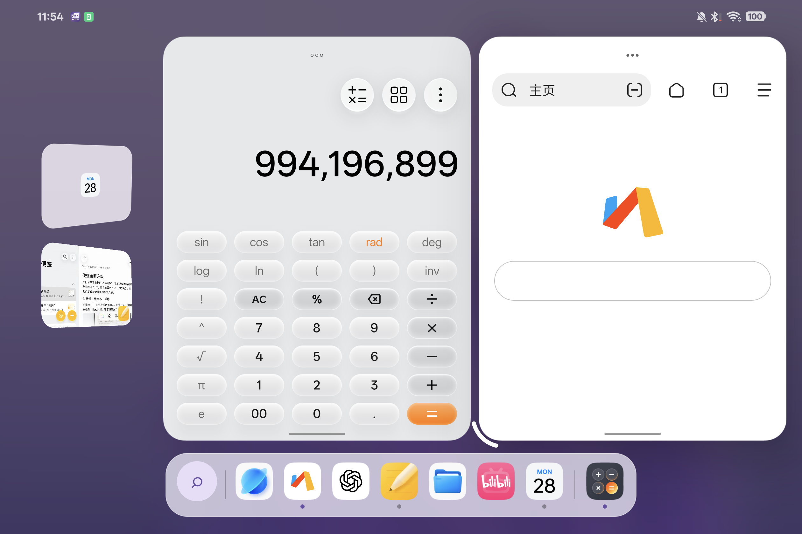
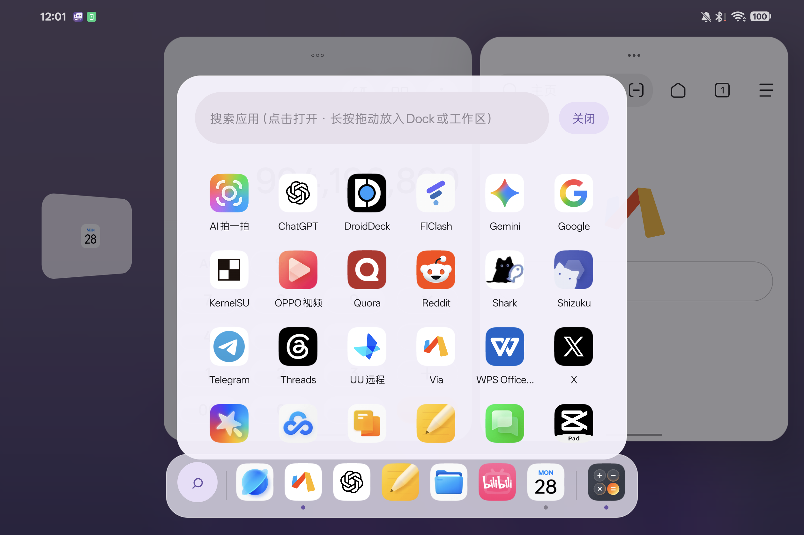

<div align="center">
  
  <h1>StageLab Native（原生台前调度）</h1>
  <p><strong>面向 Android 平板与折叠屏的原生级 iPad Stage Manager LSPosed 模块</strong></p>
  <p>
    <a href="README.md">English</a> ·
    <a href="#核心特性">核心特性</a> ·
    <a href="#兼容性支持">兼容性支持</a> ·
    <a href="#安装与使用">安装与使用</a> ·
    <a href="#编译构建">编译构建</a>
  </p>
</div>

---

StageLab Native 基于系统原生 `ShellTaskOrganizer`、`WindowContainerTransaction` 与 ColorOS 原生浮窗引擎（Flexible Window），在 Android 13–17 平板及折叠屏设备上提供接近 iPadOS 的 **120fps 台前调度（Stage Manager）** 体验——所有应用窗口均为系统原生真实任务窗口，非录屏镜像、非 WebView 模拟、非无障碍伪装。

> 在开关关闭台前调度模式时，模块内系统框架 / SystemUI / 桌面 Hook 门控同步归零退出，无残余窗口或手势拦截，可随时恢复系统原生体验。

## 效果展示

| 控制面板与诊断页 | 横屏多窗平铺与左侧 3D 工作区栏 | 120fps 物理弹簧应用搜索 |
|---|---|---|
|  |  |  |

## 核心特性

- **原生多窗口工作区（Stage）**：支持将多个应用放入同一工作区自由排布，支持 2–3 窗自动无遮挡平铺、4+ 窗级联扩展，以及每个工作区独立的侧边悬浮迷你小窗（`FloatHandle` 独立记忆与状态切换）。
- **横竖屏自适应布局与旋转校准**：
  - **横屏模式**：2～3 窗口自动等宽并排多列展示；
  - **竖屏模式**：2～3 窗口自动转为全宽上下堆叠多行展示，彻底告别竖屏窄条挤压；
  - **动态方向切换适配**：实时响应屏幕旋转，自动清理系统旋转过渡残留缩放（确保横转竖全尺寸 `scale = 1.0` 展开），并区分记录横/竖屏两套窗口记忆。
- **左侧 3D 最近工作区栏 & 120fps 神奇移动过渡**：
  - 基于原生 `TaskSnapshotManager` / `ActivityTaskManager` 拉取高清快照（自动避让 `FLAG_SECURE` 隐私页面）；
  - 双阶段 120fps Choreographer 过渡遮罩动画，点击即可切组、向内拖拽合并入当前工作区。
- **底部毛玻璃 Dock 与零延迟“神奇绽放”应用搜索（`⌕`）**：
  - 预暖常驻 `HAS_DRAWN` 窗口配合物理弹簧驱动，任意毫秒点击遮罩或 Dock 按钮均可瞬间打断动画；
  - **统一 120fps 自由拖拽体系**：从应用搜索或 Dock 栏任意位置起拖，即可拖入 Dock 指定槽位并实时让位预览固定、Dock 内拖动重排、拖至顶部胶囊或 Dock 两侧边缘取消固定，或直接拖放至当前工作区 / 左侧 3D 工作区卡片完成合并；
  - 打开应用搜索期间点击 Dock 图标或暴露出的左侧工作区卡片，自动收起搜索面板并平滑切换工作区。
- **多设备多版本兼容性诊断页**：内置实时探针面板，直观查看所有 `system_server` 与 `SystemUI` Hook 命中情况（`命中 / 回退 / 缺失`），支持一键复制完整环境报告。

## 兼容性支持

| 项目 | 支持范围 |
|---|---|
| **Android 版本** | **Android 13 – 17**（API 33 – 37，APK `minSdk = 33`） |
| **Xposed 框架** | **LSPosed / Vector**（`xposedminversion = 82`） |
| **推荐作用域（Scope）** | `system`（系统框架）、`com.android.systemui`（系统界面）、`com.android.launcher`（系统桌面） |
| **系统适配路径** | **ColorOS 13 – 17 / OxygenOS / realme UI**（原生 Flexible Window 路径）+ **AOSP Freeform**（自动降级 `WCT#setBounds` / `WINDOWING_MODE_FREEFORM` 兜底） |
| **屏幕形态与避让** | 折叠屏（`Foldable/Compact`）、8.8 寸小平板（`Mini Tablet`）、11–12.1 寸平板（`Standard Tablet`）、13.2 寸+大平板（`Large Tablet`），自动计算挖孔与三键导航栏安全区 |
| **真机实测基准** | OPPO Pad mini (`OPD2515`)，Android 17 (API 37)，ColorOS `V17.0.0`，`1680×2520 @ 120 Hz` |

## 安装与使用

> 从旧包名 `dev.stagelab.nativehook` 迁移时，请先禁用旧模块并重启，卸载旧版后再安装、启用新版。新包名不能覆盖安装旧版。

1. 前往 [GitHub Releases](https://github.com/luckylca/pad-stage-manager/releases)（或 LSPosed 模块仓库）下载最新版 APK 并安装。
2. 打开 **LSPosed / Vector**，勾选启用 **StageLab Native (`io.github.luckylca.stagelab`)**，确认作用域已勾选：
   - `system`（系统框架）
   - `com.android.systemui`（系统界面）
   - `com.android.launcher`（系统桌面）
3. 重启或软重启设备一次（注意避免误触丢 Root 的冷重启方案，KernelSU 环境推荐使用 `ksud soft-reboot`）。
4. 打开桌面的 **StageLab Native** 应用，授予通知权限后打开 **“启用台前调度”** 开关即可进入工作台模式；需要退出时点击常驻通知或返回首页关闭开关即可。

### 紧急禁用与恢复

```bash
# 仅立即关闭台前调度运行状态并恢复原生桌面
adb shell am broadcast -a io.github.luckylca.stagelab.ACTION_STAGE_CMD --es cmd disable_module -p com.android.systemui

# 通过 Vector / LSPosed CLI 完全禁用模块并重启 SystemUI 与桌面
adb shell su -c "/data/adb/lspd/cli modules disable io.github.luckylca.stagelab"
adb shell su -c "pkill -f com.android.systemui; pkill -f com.android.launcher"
```

更多说明见 [stage-native/docs/SAFE_RECOVERY.md](stage-native/docs/SAFE_RECOVERY.md)。

## 编译构建

```powershell
cd stage-native
.\gradlew.bat :core:test :module:assembleDebug :module:assembleRelease
```

产物输出路径：
- Debug：`stage-native/module/build/outputs/apk/debug/module-debug.apk`
- Release：`stage-native/module/build/outputs/apk/release/module-release.apk`

如需自定义 Release 签名，可在环境变量配置 `STAGELAB_KEYSTORE_FILE`、`STAGELAB_KEYSTORE_PASSWORD`、`STAGELAB_KEY_ALIAS`、`STAGELAB_KEY_PASSWORD`，或在 `stage-native/keystore.properties` 中填入密钥配置（已默认加入 `.gitignore`）。

## 仓库目录

```text
pad-stage-manager/
├── stage-native/                 # 当前主力开发工程：LSPosed / Xposed 模块（Android 13–17）
│   ├── core/                     # 纯 Kotlin Stage 状态机与 JUnit 单元测试
│   └── module/                   # Android 模块工程（Hook、系统桥接、悬浮层与 Material You 设置页）
├── app/                          # 历史归档 v1 原型（基于 Shizuku Freeform 的独立应用方案）
├── docs/native/                  # StageLab Native 展示截图与文档
├── .github/workflows/build.yml   # GitHub Actions CI 编译测试与 Release 发布工作流
├── LICENSE                       # GNU General Public License v3.0
├── README.md                     # 英文 README（LSPosed 仓库展示页）
└── README_CN.md                  # 简体中文 README
```

## 开源协议

本项目基于 **GNU General Public License v3.0** 协议开源，详见 [LICENSE](LICENSE)。
