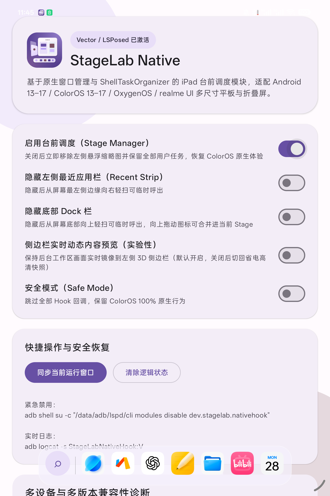
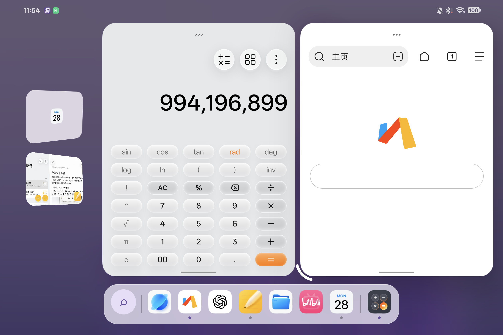
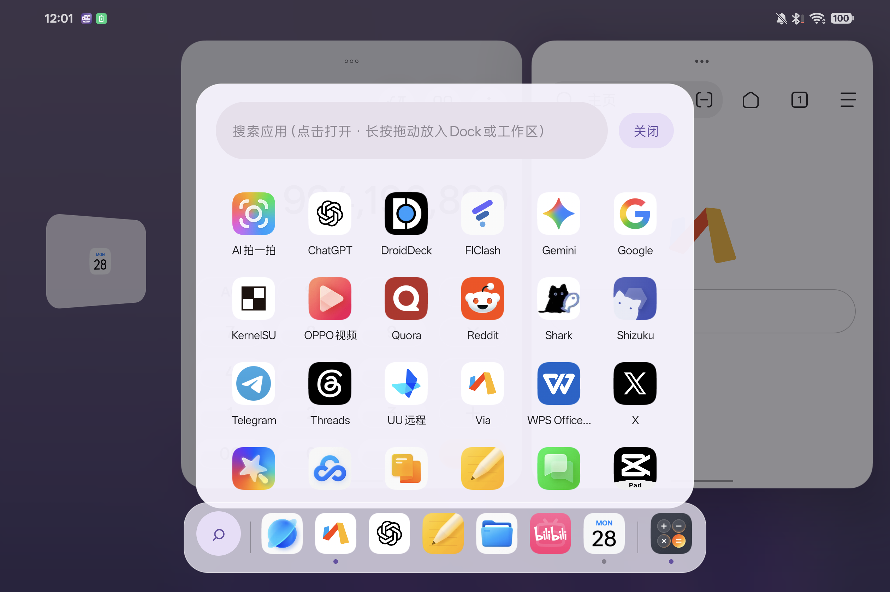

  
  <h1>StageLab Native（原生台前调度）</h1>
  
<strong>面向 Android 13–17 平板与折叠屏的原生级 iPad Stage Manager LSPosed 模块</strong>

  
  
  
  

---

StageLab Native 基于系统原生 `ShellTaskOrganizer`、`WindowContainerTransaction` 与 ColorOS 原生浮窗引擎（Flexible Window），在 Android 13–17 平板及折叠屏设备上提供原生级 **120fps 台前调度（Stage Manager）** 体验——所有应用窗口均为真实系统任务窗口，非录屏镜像、非 WebView 模拟、非无障碍伪装。

> [!IMPORTANT]
> 本模块需要 Root（Magisk / KernelSU）与 LSPosed / Vector 环境，推荐启用作用域：`system`、`com.android.systemui`、`com.android.launcher`。关闭台前调度开关时所有系统 Hook 门控同步归零退出，无残余窗口或手势拦截。

## 效果展示

| 控制面板与诊断页 | 横屏多窗平铺与左侧 3D 工作区栏 | 120fps 物理弹簧应用搜索 |
|---|---|---|
|  |  |  |

## 核心特性

- **原生多窗口工作区（Stage）与自由平铺**：横屏 2～3 窗自动等宽并排，竖屏自动转为全宽上下堆叠行；支持旋转屏幕实时尺寸自适应与横竖屏独立窗口记忆，以及每工作区独立的侧边迷你悬浮窗（`FloatHandle`）。
- **左侧 3D 最近工作区栏 & 120fps 神奇移动过渡**：实时拉取系统 `TaskSnapshotManager` / `ActivityTaskManager` 高清缩略图（自动避让 `FLAG_SECURE` 隐私窗口），点击切换工作区、向内拖拽合并入当前工作台。
- **底部毛玻璃 Dock 与零延迟物理弹簧应用搜索（`⌕`）**：预暖常驻窗口支持任意毫秒点击遮罩/Dock 打断动画；长按搜索卡片或直接从 Dock 图标自由拖拽至 Dock 指定槽位让位固定、水平排序、拖动取消固定，以及拖放合并入当前工作区或左侧 3D 工作区卡片。
- **多设备多版本兼容性**：支持 **ColorOS 13–17 / OxygenOS / realme UI** 原生浮窗路径，并在 **AOSP** 环境自动回退至标准 `WindowContainerTransaction#setBounds` + `WINDOWING_MODE_FREEFORM`；内置实时探针诊断面板（`OPPO Pad mini / ColorOS V17.0.0 / Android 17` 实测通过）。

## 安装与作用域

1. 下载并安装最新版 APK（`StageLab-Native-<version>.apk`）。
2. 在 **LSPosed / Vector** 中启用 **StageLab Native (`io.github.luckylca.stagelab`)**，确认作用域包含：
   - `system`（系统框架）
   - `com.android.systemui`（系统界面）
   - `com.android.launcher`（系统桌面）
3. 重启或软重启一次设备后，打开 **StageLab Native** 开启 **启用台前调度** 开关即可体验。

更多说明、构建指南与紧急恢复命令行见源码仓库：[luckylca/pad-stage-manager](https://github.com/luckylca/pad-stage-manager#readme)。
